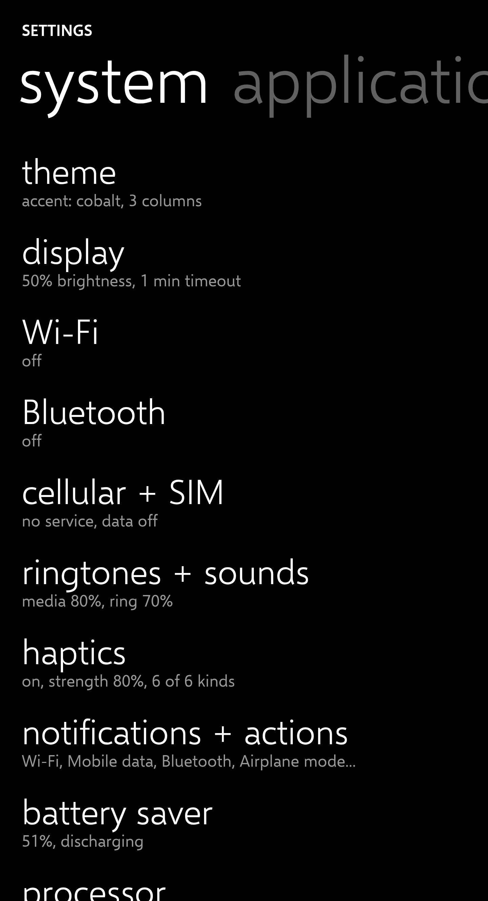
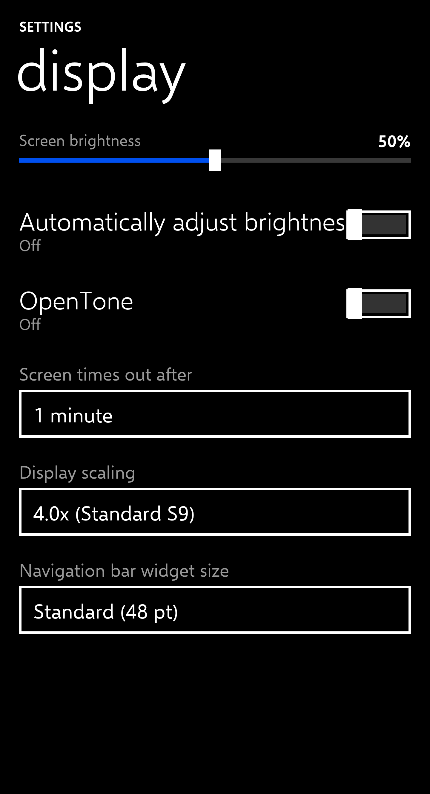
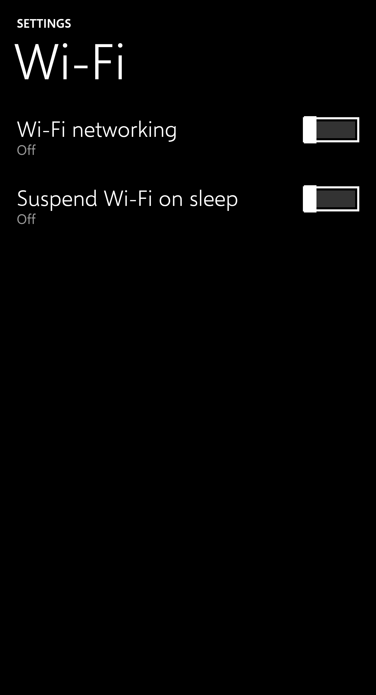
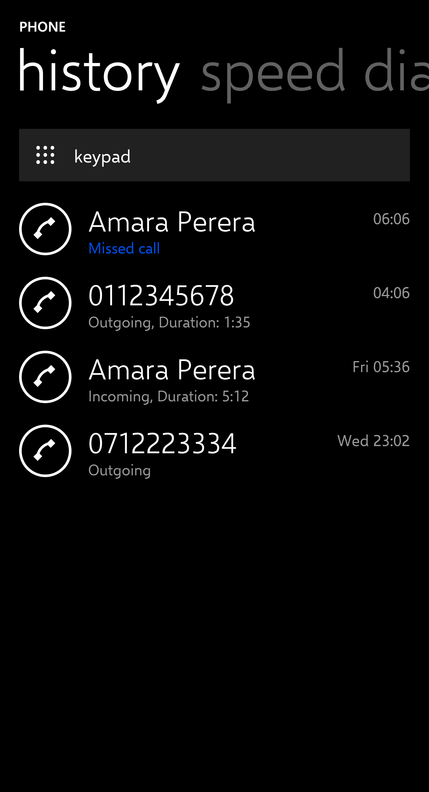
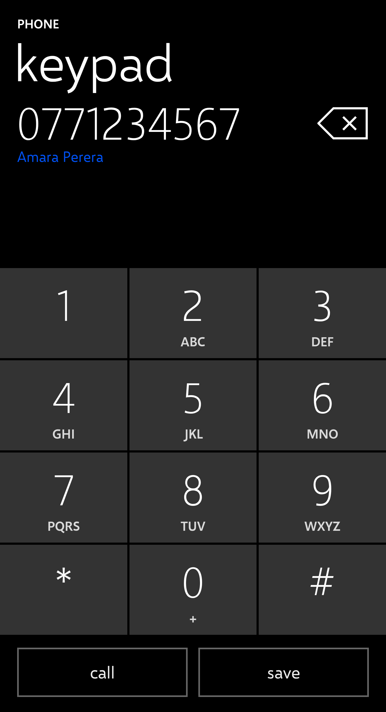
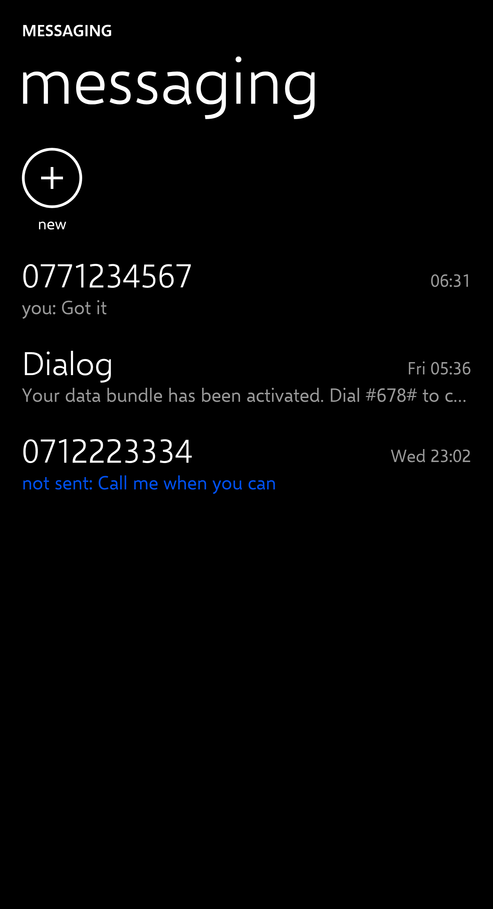

<div align="center">

# metro-ui

**A Claude skill for building Windows Phone 8.1 ("Metro", Lumia) interfaces that actually look like the real thing.**

Measured geometry · official colour and type · a render-and-score loop · a grammar for designing your own icons

[](LICENSE)
[](THIRD_PARTY.md)

</div>

---

## Why

Asked for "a Windows Phone UI", most models produce Material with rounded cards and a blue accent. The real thing is stricter: black canvas, a giant lowercase Segoe UI Light title, 16 pt margins, rectangular toggles, tilt-on-press, turnstile page transitions. Every number matters, and models guess them.

`metro-ui` replaces guessing with data and a feedback loop:

- **Measured reference.** Every pitch, size, colour and duration lives in `references/` with a machine-readable constants block.
- **A kit that applies it.** `kit/metro.css` + `kit/metro.js` reproduce the controls and behaviours.
- **A loop that checks it.** Render in headless Chromium at the phone's native geometry, then score the result band-by-band against a reference spec. The error is reported in points, so an agent knows *what to fix*, not just that it failed.

On held-out pages built by an agent that had only the skill and a content brief (no layout hints) the loop reaches **97 / 100** (messaging list), **97** (call history), and passing specs on settings pages.

## Gallery

Rendered with the bundled Selawik fallback only (no proprietary fonts), straight from `examples/`:

| settings | display | wi-fi |
|---|---|---|
|  |  |  |

| call history | keypad | messaging |
|---|---|---|
|  |  |  |

## What is inside

```
SKILL.md          entry point for Claude: rules, workflow, skeleton markup
kit/              metro.css, metro.js, Selawik fonts (OFL)
references/       measured numbers: tiles, controls, page anatomy, motion, system surfaces,
                  icons, sound/haptics, official theme values, Android reskin notes
scripts/          capture.sh (HTML to PNG), compare.py, spec_check.py, audit.py, icon.py
evals/            content-only briefs, reference band specs, evals.json
examples/         settings, wi-fi, call history, messaging, icon specs
harness/          Dockerfile for the headless renderer
```

## Quick start

```bash
# 1. Build the renderer once (needs Docker)
docker build -t metro-capture harness/

# 2. Render an example at the native phone geometry (360 pt wide, 4x)
sh scripts/capture.sh examples/settings-wifi/index.html out/wifi.png 360 664 4

# 3. Lint it and check it against the reference spec
python3 scripts/audit.py examples/settings-wifi/index.html
python3 scripts/spec_check.py out/wifi.png evals/specs/settings-wifi.json
```

Use it as a Claude skill by placing this folder in your skills directory (for Claude Code: `~/.claude/skills/metro-ui/`), then ask, for example: *"Build a Windows Phone 8.1 settings page for notifications with three toggles and a picker."*

Minimal page:

```html
<link rel="stylesheet" href="kit/metro.css"><script src="kit/metro.js" defer></script>
<div class="m-page">
  <div class="m-caps">Settings</div>
  <div class="m-title">sounds</div>
  <div class="m-body">
    <div class="m-switch"><div class="t">Vibrate</div><div class="s">On</div><div class="m-toggle on"></div></div>
    <div class="m-picker"><div class="m-caption">Ringtone</div><div class="box">Classic</div></div>
  </div>
</div>
```

## The rules in one screen

| | |
|---|---|
| Canvas | 360 x 740 pt (status 28, app 672, nav 40). Page-only 360 x 664. Capture at scale 4. |
| Colour | `#000` background, `#fff` text, `#999` secondary, `#1F1F1F` chrome, one accent (default `#0050EF`) from the official 20-colour palette. |
| Type | Segoe UI Light/Semilight for titles and values, Regular for body, Semibold for the caps app name. Selawik fallback. |
| Shape | Square corners. No shadows, gradients or blur. 2 pt white outlines. |
| Rhythm | 16 pt margins, header 108 pt, row pitches 59 / 62 / 64 / 66. **No `line-height`**: the pitches assume natural line height. |
| Start | No clock. Tiles 49.5 / 106 / 219x106, gutter 7, margin 14. |
| Motion | Press = 3D tilt 14 deg (70 ms in, 160 ms out). Pages = turnstile (128 ms out, 180 ms in, 33 ms stagger). |

## Designing icons

The skill does **not** ship an icon set. It teaches a grammar (white monoline, 20 pt box, 2 pt round strokes, 44 pt ring) and gives you `scripts/icon.py` to render any glyph from a handful of primitives, and to lint SVGs you drew yourself. See `references/icon-design.md`.

```bash
python3 scripts/icon.py render examples/icons/mail.json out/mail.svg
python3 scripts/icon.py lint out/mail.svg
```

## The improvement loop

1. A fresh agent receives only `SKILL.md` and a brief from `evals/briefs/` (never the spec).
2. It builds the page, captures it, and runs `audit.py` and `spec_check.py`.
3. Every place the agent was misled becomes a patch to the kit or a reference.
4. Repeat on a different page. See `evals/evals.json`.

The loop already caught: a 1.2 line-height assumption that shifted every baseline, a CSS rule that forced titles to lowercase, a missing wrap guard on switch rows, and font-metric differences between Segoe UI and Selawik.

## Reskinning a real Android ROM

`references/android-reskin.md` documents what can and cannot be restyled in place on Android 7.1 (static overlays, patched system APKs, fonts, boot animation, sounds, window animations) with a recovery ladder. `scripts/android-probe.sh` is a read-only device probe.

## Honest limits

See `references/11-statements-of-fact.md`: some values (haptic timing, a few transitions, light theme) are unmeasured, and the official WP8 title size (54 pt) differs from the measured pages (48 pt). Run the tests before trusting a number.

## License

MIT for code and data (`LICENSE`). Selawik fonts under the SIL OFL. Segoe fonts and all Microsoft/Nokia trademarks are **not** included and not affiliated. See `THIRD_PARTY.md`.
